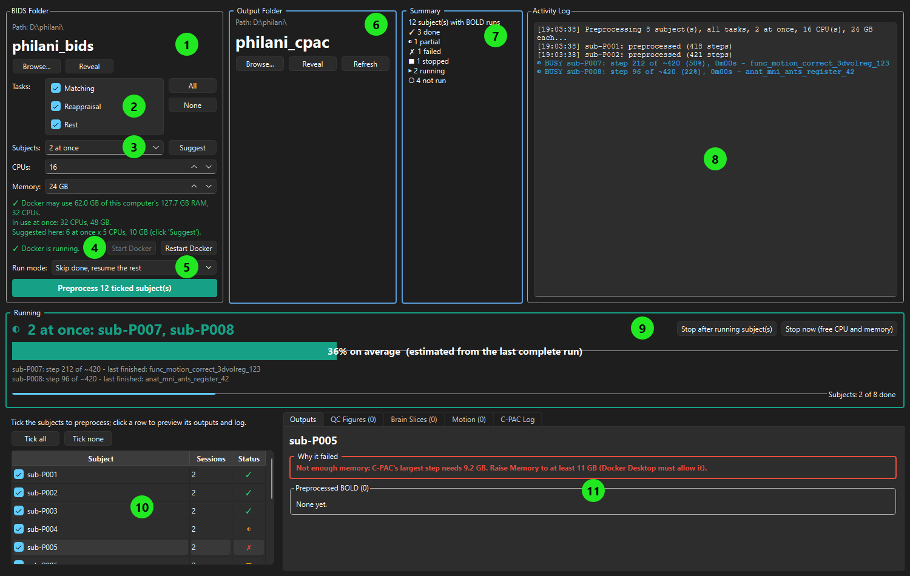

# Preprocessing (C-PAC)

This is the step after [BIDS conversion and crosscheck](bids-conversion.md): it cleans up
each subject's fMRI scans so they are ready for analysis. This page is for anyone running
preprocessing with the **fMRI Preprocess** window — no coding background needed.

The work itself is done by [C-PAC](https://fcp-indi.github.io/), a standard fMRI
preprocessing pipeline. C-PAC runs inside **Docker**, a program that runs Linux software
on Windows in a sealed-off box (a *container*). You don't need to know Docker; the window
starts it for you. You only need Docker Desktop installed and running.

!!! info "Your BIDS folder is never changed"
    C-PAC only *reads* the BIDS folder (Docker opens it read-only). Everything it makes
    goes into the separate **output folder** you pick. If preprocessing goes wrong, delete
    the output and run it again; your BIDS data is untouched.

## What preprocessing does

For each subject, C-PAC's standard `preproc` pipeline:

- **Anatomical scan (T1w):** removes the skull, splits the brain into grey matter, white
  matter and fluid, and warps the brain onto a standard template (MNI) so subjects can be
  compared.
- **Functional scans (BOLD):** corrects for slice timing and head motion, lines each run up
  with the subject's anatomical scan, warps it to the template, removes noise (motion,
  white-matter and fluid signals, slow drifts), and smooths it slightly.

It also draws quality-control (QC) figures and a motion summary, which you can look at in
the window (panel 11).

!!! note "Going further"
    The exact steps and settings are listed in `fmri_preprocess --help` and in C-PAC's
    documentation for its `preproc` preset (C-PAC release v1.8.7).

## Before you start

1. **Install Docker Desktop** and start it. The first run downloads the C-PAC image
   (about 15 GB, once); that can take half an hour or more.
2. **Give Docker enough memory.** Each subject needs at least 8 GB, and about 10 GB is
   safer. Docker only uses what it is allowed — see
   [Docker's memory and CPU limits](#dockers-memory-and-cpu-limits) below.
3. **Use a fast local disk** (an SSD) for the output folder — not OneDrive or a network
   drive. C-PAC writes a lot of small files, and a slow disk slows everything down.
4. **Check the free space.** Plan on roughly 2–5 GB of output per subject, plus about the
   same again for C-PAC's `working/` folder while it runs.

## The window, at a glance

Open a terminal and type:

```powershell
fmri_preprocess_gui
```

The window remembers your folders and settings, so after the first time it opens where you
left off.

Everything the window does lives in one of the 11 numbered panels below. The screenshot is
the map; the numbered sections after it explain each panel in the order you'd use them.



!!! tip "Not sure what something does?"
    Hover over any button or setting: a short tooltip explains it before you click.

### 1. BIDS Folder

Click **Browse...** and pick the crosschecked BIDS folder (the one with
`dataset_description.json` in it). **Reveal** opens it in Explorer.

Only the `sub-<id>` folders are passed to C-PAC, so anything still waiting in
`crosscheck_pending/` is never used by mistake.

### 2. Tasks

Tick the fMRI tasks (BOLD runs) to preprocess; scroll if there are more than fit. **All** and
**None** tick or untick everything. With every task ticked, every BOLD run is used.

- Each subject still runs **once**, with all its ticked tasks together.
- A subject counts as done when **each** ticked task it has is done. A task a subject never
  had (e.g. a missing scan) is simply ignored for that subject.
- The subject list, the status icons and the previews (panels 10 and 11) follow the ticks.

### 3. Subjects at once, CPUs and Memory

- **Subjects** — how many subjects run side by side, each in its own container.
- **CPUs** and **Memory** — what *each* subject may use.

So "2 at once, 16 CPUs, 24 GB" uses 32 CPUs and 48 GB in total. Many C-PAC steps only use
one CPU, so several subjects with a few CPUs each finish a batch sooner than one subject
with all of them.

**Suggest** fills in all three from Docker's limits: about 10 GB and at least 2 CPUs per
subject, and never more subjects than you've ticked.

The coloured line below explains what you've chosen:

| Colour | Meaning |
| --- | --- |
| Green ✓ | It fits within Docker's limits. "In use at once" shows the totals. |
| Orange ⚠ | The totals are more than Docker allows. Too much **memory** can get a subject killed halfway; too many **CPUs** only slows things down. **Preprocess** asks before it starts. |
| Red ⚠ | It can't work: e.g. Memory is more than Docker allows for even one subject, or the PC has less than 8 GB. |

When your choice differs from the suggestion, the line also says what **Suggest** would
pick.

### 4. Docker

Shows whether Docker is running; it is re-checked every 30 seconds.

- **Start Docker** — starts Docker Desktop for you (takes up to a minute or two).
- **Restart Docker** — restarts it. Use this when a subject fails with "Docker lost access
  to the output folder". It stops anything running in Docker.

### 5. Run mode and Preprocess

| Run mode | What it does |
| --- | --- |
| **Skip done, resume the rest** | The usual choice. Finished subjects are skipped; unfinished, stopped or crashed ones pick up where they stopped. |
| **Resume all (reuse finished steps)** | Runs every ticked subject again, but reuses what C-PAC already finished. |
| **Rerun from scratch (delete previous results)** | Deletes each ticked subject's earlier output and working folders first (it asks before deleting). Use it after changing the pipeline. Logs are kept. |

!!! tip "Keep the CPUs the same when resuming"
    C-PAC only reuses finished steps when the settings match. Change the CPUs between runs
    and it may redo the functional steps.

Then click **Preprocess N ticked subject(s)**. The folder and settings panels lock while it
runs; the subject list stays clickable so you can look at results as they come in.

### 6. Output Folder

Click **Browse...** and pick where the results go (not inside the BIDS folder). **Refresh**
re-scans both folders, e.g. after copying in new subjects.

What C-PAC writes there:

| Folder | What's in it |
| --- | --- |
| `output/pipeline_cpac_preproc/sub-<id>/ses-<n>/` | The results: preprocessed scans, masks, QC figures, motion tables. |
| `log/` | C-PAC's logs, plus `fmri_preprocess_sub-<id>.txt`: everything C-PAC printed for that subject. |
| `working/` | C-PAC's finished steps. This is what lets a stopped or crashed subject resume. It is large; once a subject is ✓ done, its folder here can be deleted to save space. |

### 7. Summary

How many subjects have the ticked tasks, and how many are in each state (see the icons in
panel 10).

### 8. Activity Log

A running record of the session: what started, what finished, what failed and why. While
subjects run, the bottom lines (in blue) show each running subject's progress, rewritten in
place.

### 9. Running

Only shown while preprocessing runs.

- **The title** shows which subjects are running.
- **The big bar** shows progress through C-PAC's steps (averaged over the running subjects).
  C-PAC doesn't say how many steps it will take, so the first run shows a moving bar; after
  one subject finishes, the window remembers its step count and shows a percentage.
- **The bottom bar** counts finished subjects.
- **Stop after running subject(s)** — lets the running subjects finish, then starts no new
  ones.
- **Stop now (free CPU and memory)** — stops the running subjects at once. See
  [Stopping, and picking up again](#stopping-and-picking-up-again).

### 10. Subject list

One row per subject that has the ticked tasks. The **tick box** chooses who runs when you
click **Preprocess**; clicking a row only shows that subject's details (panel 11). **Tick
all** / **Tick none** change every box at once. New subjects start ticked.

| Icon | Meaning |
| --- | --- |
| ✓ | Done: every session has a preprocessed scan of each ticked task, and every output C-PAC planned. |
| ◐ | Partly done: some ticked tasks are preprocessed, others not yet (e.g. you ran one task first). |
| ✗ | Failed: C-PAC ran but its output is incomplete. The Outputs tab says why. |
| ■ | Stopped by you before it finished. Run it again to resume. |
| ▶ | Running now. |
| ○ | Not run yet. |

**Sessions** is the number of scan sessions with the ticked tasks.

### 11. Subject details

Click a subject to see its results in five tabs. The tab names show how many items each
has.

- **Outputs** — the most useful tab when something went wrong:
    - **Why it failed** (red) — a plain-English cause, read from C-PAC's log, with what to
      do about it. **Stopped before it finished** (orange) when you stopped it.
    - **Not all tasks preprocessed** — which ticked tasks are still to do.
    - **Not complete: N expected outputs missing** — files C-PAC planned to write but
      didn't. Running it again with "Skip done, resume the rest" fills the gaps.
    - **Preprocessed BOLD** — the finished scans, each with **Reveal** to open its folder.
- **QC Figures** — C-PAC's quality pictures: head motion, framewise displacement, BOLD
  signal-to-noise. Pick one from the list, or step through with **◀ Prev** / **Next ▶**.
  **Zoom In**, **Zoom Out** and **Fit to Window** change the size; **Reveal** opens the file's
  folder.
- **Brain Slices** — slices through the brain with outlines on top, to check skull
  stripping, tissue masks, how well each scan lines up with the anatomy (coregistration)
  and with the template (normalisation). Left on screen is the subject's left.
- **Motion** — C-PAC's motion summary, one row per run (mean and maximum framewise
  displacement, DVARS, ...).
- **C-PAC Log** — the end of everything C-PAC printed for this subject.

!!! tip "What am I looking at?"
    The **?** button on the QC Figures, Brain Slices and Motion tabs opens a short note on
    what the current picture shows and what a problem looks like.

## Running several subjects at once

1. Tick the subjects and tasks.
2. Click **Suggest** (panel 3). Lower **Subjects** if you want to leave room for other work
   on the PC.
3. Click **Preprocess**.

Starts are spaced 10 seconds apart. Each subject runs in its own container, named
`fmri_cpac_sub-<id>`, so the same subject can never run twice at once.

How long does it take? A full subject with two or three functional runs takes very roughly
**2–4 hours**. With 6 at once, 250 subjects take about a week; with 2 at once, about two to
three weeks. After the first subjects finish, the Activity Log times give you the real
figure for your PC.

## Stopping, and picking up again

Someone needs the PC? Click **Stop now (free CPU and memory)** in panel 9 and confirm. About
10 seconds later C-PAC has stopped and the CPUs and memory are free. The stopped subjects
show **■**.

To carry on later: keep the same settings, choose **Skip done, resume the rest**, and click
**Preprocess**. Finished subjects are skipped, and each stopped subject picks up from its
last finished step. Only the step that was half-done when you stopped is redone (usually
minutes, at most about an hour).

**Closing the window** while preprocessing runs asks what to do:

- **Stop C-PAC and close** — the same as Stop now, then closes.
- **Leave running and close** — the running subjects carry on in Docker; no new ones start.

## Docker's memory and CPU limits

Docker Desktop on Windows only lets C-PAC use part of the PC: by default about **half the
RAM** and all CPUs. The window reads these limits (panel 3) but can't change them; you set
them once per PC.

1. Open **PowerShell** and check what Docker gets now:

    ```powershell
    docker info --format "{{.NCPU}} CPUs, {{.MemTotal}} bytes"
    ```

2. Open (or create) Docker's settings file:

    ```powershell
    notepad $env:USERPROFILE\.wslconfig
    ```

3. Add these lines, leaving about a quarter of the RAM for Windows. For a PC with 128 GB:

    ```ini
    [wsl2]
    memory=96GB
    processors=32
    ```

4. Save, then restart Docker. Do this only when nothing is preprocessing:

    ```powershell
    docker desktop stop
    wsl --shutdown
    docker desktop start
    ```

5. Run step 1 again to check, then click **Suggest** in the window.

It doesn't matter whether you start Docker Desktop from PowerShell or the desktop icon:
it's the same program either way.

## When something goes wrong

The **Outputs** tab (panel 11) and the Activity Log explain most problems in plain English.
The common ones:

| Message | What to do |
| --- | --- |
| Not enough memory: C-PAC's largest step needs N GB | Raise **Memory** to at least the number it gives (Docker must allow it), then run again. |
| Docker isn't running | Click **Start Docker** (panel 4) and wait for the green "Docker is running". |
| Docker lost access to the output folder ('Input/output error') | Not a pipeline problem: the PC slept, or Docker's file sharing dropped. Click **Restart Docker**, then run again; finished steps are reused. |
| This subject's C-PAC container is already running in Docker | It's still running from an earlier session. Let it finish, or stop it in Docker Desktop. |
| Step '...' failed: ... only N usable volumes | The scan is too short, likely an incomplete scan. Check it in the crosscheck tool. |
| No known cause recognised | Look at the **C-PAC Log** tab, or the full log in `log/fmri_preprocess_sub-<id>.txt`. |

## The command line

Everything the window does also works from a terminal, e.g. on a server or in a script:

```powershell
fmri_preprocess D:\philani_bids D:\philani_cpac --parallel 3 --n-cpus 4 --mem-gb 10
```

| Option | What it does |
| --- | --- |
| `--subject_id P001` | Only this subject. |
| `--task Rest` | Only this task; repeat for several (`--task Rest --task Matching`). |
| `--parallel N` | Subjects at once (prints a warning and a suggestion if it doesn't fit Docker's limits). |
| `--n-cpus`, `--mem-gb` | CPUs and memory per subject. |
| `--rerun` | Also run subjects that are already done (reuses finished steps). |

Run `fmri_preprocess --help` for the full list.

---

**Before this:** [BIDS conversion](bids-conversion.md) and crosscheck.
